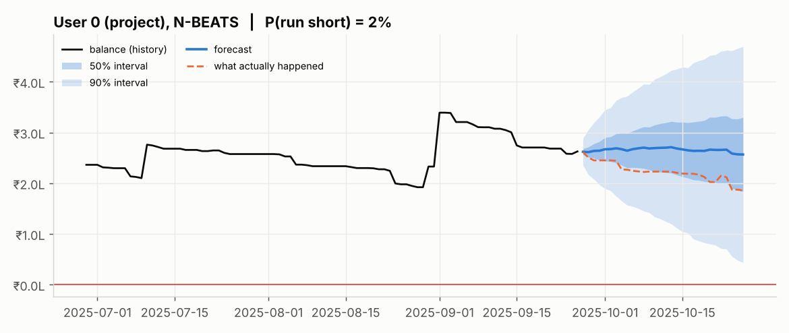
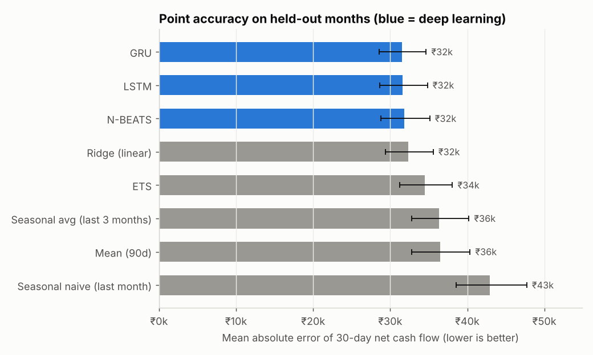
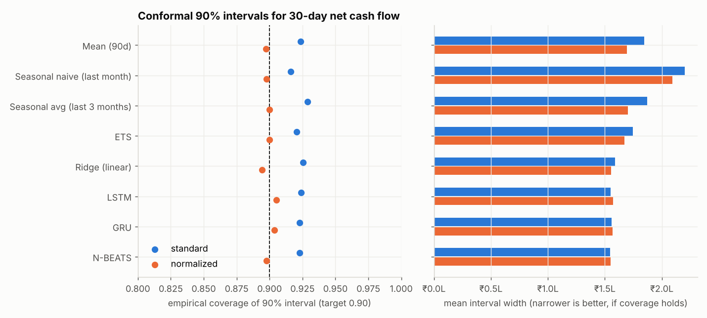
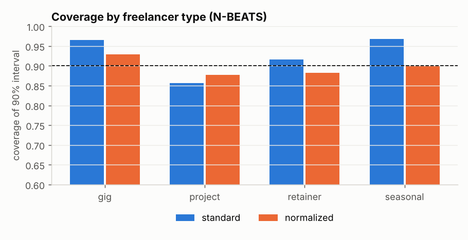
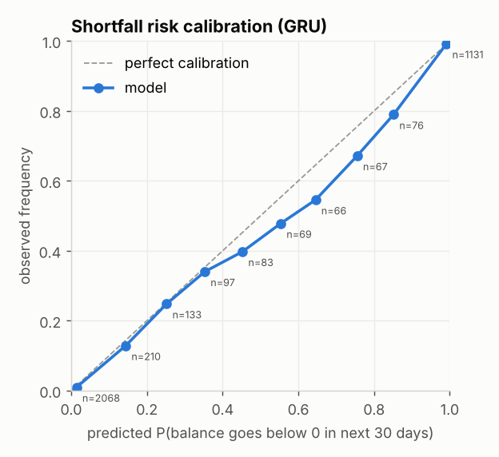
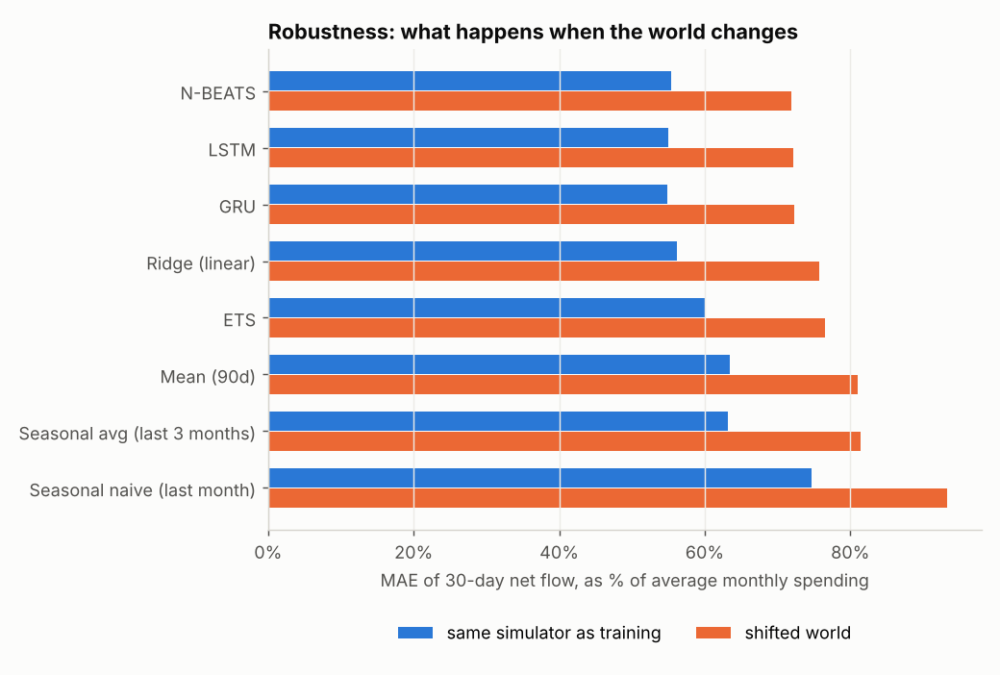

# Cash-flow forecasting for freelancers: deep learning vs simple baselines, with uncertainty

A freelancer's income arrives in irregular lumps while rent, EMIs and card bills arrive like
clockwork. This project forecasts a person's **income and expenses for the next 30 days** from
their past transactions, and answers the question that actually matters to them:

> **"What's the chance I run short this month?"**

The point of the project is an **honest comparison**: LSTM, GRU and N-BEATS (TensorFlow/Keras)
against naive, seasonal, ETS, Prophet and linear baselines. Every model is wrapped in **conformal
prediction** so that it outputs calibrated intervals and a shortfall probability, not just one number.



---

## What's in the project

| Part | What was done |
|---|---|
| **Data** | A realistic freelancer simulator (4 personas, irregular gaps, late or unpaid invoices, month-start rent, card-bill lumps, quarterly tax, Diwali, shocks, spending that reacts to balance) **plus** a deliberately *shifted* world to test whether models only learned the simulator. A PaySim pipeline (Kaggle) is included as a second, independently generated dataset. |
| **Models** | Mean, Seasonal naive, Seasonal average, **ETS**, **Prophet**, Ridge, **LSTM**, **GRU**, **N-BEATS**; optional **Chronos-Bolt** zero-shot foundation model. |
| **Evaluation** | Time-ordered train / validation / calibration / test split; 200 users × 3 years; 4,000 test windows; deep models trained with 3 seeds; **95% CIs from a user-level paired bootstrap**. |
| **Uncertainty** | Split conformal intervals (standard and volatility-normalized), checked against **MAPIE**; conformal predictive distribution of the lowest balance → **P(balance < ₹0 in the next 30 days)**; reliability diagram; coverage per freelancer type and under distribution shift. |
| **Demo** | Streamlit app: choose a simulated freelancer or **upload your own bank-statement CSV** → forecast, fan chart, shortfall probability, all models side by side. |

## Headline results (simulated data, 200 users, held-out last 5 months)

Average 30-day income ≈ ₹56k and spending ≈ ₹57k per person. Errors are for the **30-day net cash
flow** (income − expenses). Deep models: mean over 3 seeds (± seed std).

| Model | MAE 30-day net | Skill vs seasonal avg | Train+predict time |
|---|---:|---:|---:|
| **N-BEATS** | **₹31,720** ± 266 | **+12.7%** | 65 s |
| **LSTM** | ₹31,722 ± 86 | +12.7% | 357 s |
| **GRU** | ₹31,773 ± 189 | +12.6% | 385 s |
| Ridge (linear, same inputs) | ₹32,314 | +11.1% | 0.5 s |
| ETS | ₹34,457 | +5.2% | 595 s |
| Seasonal avg (last 3 months) *(reference)* | ₹36,334 | 0 | 11 s |
| Mean (90 days) | ₹36,452 | −0.3% | 0.2 s |
| Seasonal naive (last month) | ₹42,941 | −18.2% | 6 s |
| Prophet *(50-user subset; see `point_metrics_prophet_subset.csv`)* | worse than ETS and even the 90-day mean on the same users | | slow |



**What this says, honestly:**

1. **Deep learning helps, but less than "used LSTM" suggests.** The deep models beat ETS by about
   8% (GRU − ETS = −₹2,932, 95% CI [−₹4,100, −₹1,734]) and the seasonal reference by about 13%.
   But a **plain linear model on the same inputs gets most of that gain**: GRU beats Ridge by only
   2.4% (CI [−₹1,402, −₹162]), and N-BEATS vs Ridge is **not significant** (CI [−₹1,096, +₹85]).
   Most of the improvement comes from the *global, scaled-window setup* (learning across 200
   people), not from recurrence.
2. **LSTM, GRU and N-BEATS are statistically tied.** N-BEATS trains about 6× faster.
3. **Prophet was the weakest non-naive model** here (on its 50-user subset it was even behind the
   90-day mean), despite having month-start and month-end regressors.
   On lumpy, mostly-zero daily series its smooth seasonal curves fit poorly.
4. **Simple models still win at timing bills.** The seasonal average has the lowest *daily expense*
   error (₹1,684 vs ₹2,164+ for deep models), because it copies the exact days rent and EMIs hit.
   Deep models get the totals right but smear the dates.

### Uncertainty: intervals that actually hold

| | Standard conformal | Normalized conformal |
|---|---|---|
| Overall coverage of the 90% interval (all models) | 0.92–0.93 (too wide) | **0.89–0.91** |
| Project freelancers (N-BEATS) | 0.86 (too narrow) | 0.88 |
| Gig workers (N-BEATS) | 0.97 (too wide) | 0.93 |
| Interval width | same for everybody | scaled to each person's volatility |

Our implementation matches MAPIE's `SplitConformalRegressor` exactly (max difference 0.0).




### "What's the chance I run short?"

| Model | Brier score of P(short) ↓ | Brier, people with < 1 month of buffer ↓ | Brier of "point forecast < 0" rule |
|---|---:|---:|---:|
| **GRU** | **0.045** | **0.084** | 0.076 |
| LSTM | 0.045 | 0.084 | 0.073 |
| N-BEATS | 0.046 | 0.086 | 0.075 |
| Ridge | 0.049 | 0.090 | 0.073 |
| Seasonal avg | 0.049 | 0.088 | 0.065 |
| ETS | 0.051 | 0.093 | 0.080 |

Turning a point forecast into a **conformal probability cuts the Brier score by 25–40%**
compared with the naive "forecast dips below zero → yes" rule. The probabilities are well calibrated
(a predicted 25% happens about 25% of the time), with mild over-prediction in the 45–85% range. The
AUC (0.985) looks great but is inflated: many windows are easy, with a large balance or already
overdrawn. The "< 1 month of buffer" column is the honest one.



### Did the models only learn the simulator?

All models were evaluated, **without retraining**, on a shifted world: payment delays ×1.8, dry
spells ×2, shocks ×2, triple the unpaid invoices.

* Every model gets 25–35% worse (relative to monthly spending). **The ranking does not change**:
  deep models stay best, but they degrade slightly *more* than ETS (+30–32% vs +28%).
* 90% conformal intervals calibrated on the old world drop to **0.88–0.89** coverage. Re-calibrating
  on recent data from the new world restores **0.90**. Practical lesson: **re-calibrate regularly.**



## What was *not* run here (and how to run it)

The environment that produced these results had no access to Kaggle or Hugging Face, so:

* **PaySim**: download `PS_20174392719_1491204439457_log.csv` from
  [Kaggle](https://www.kaggle.com/datasets/ealaxi/paysim1) into `data/`, then run
  `python scripts/run_paysim.py`. PaySim has only ~31 days and almost no repeat customers, so it is
  used for **platform-level 24-hour inflow/outflow forecasting**, not per-person (see
  [docs/METHODOLOGY.md](docs/METHODOLOGY.md#23-paysim-srccashflowpaysimpy-scriptsrun_paysimpy)).
* **Chronos-Bolt** (zero-shot foundation model):
  `pip install chronos-forecasting torch`, then `python scripts/run_experiment.py --with-chronos`.

## Quick start

```bash
python -m venv .venv && source .venv/bin/activate      # Windows: .venv\Scripts\activate
pip install -r requirements.txt

pytest -q                                   # 14 tests, ~20 s
streamlit run app/streamlit_app.py          # demo (uses the trained models in artifacts/)

python scripts/run_experiment.py --quick    # ~5 min smoke run -> results_quick/
python scripts/run_experiment.py --epochs 20   # full run, ~1 h on a 2-core CPU -> results/
```

To try the demo with your own data, export your bank statement as a CSV with columns
`date, amount` (positive = money in, negative = money out), at least ~4 months long.
`data/sample_statement.csv` shows the format.

## Repository layout

```
src/cashflow/        simulator, windows, models, conformal, metrics, plots, forecast API
scripts/             run_experiment.py (main), run_paysim.py, make_sample_statement.py
app/                 streamlit_app.py (demo)
artifacts/           trained LSTM / GRU / N-BEATS + calibration data for the demo
results/             all tables (CSV) and figures behind this README
docs/                METHODOLOGY.md, FILES.md (every file explained), GITHUB_SETUP.md
tests/               unit tests + demo smoke test
```

A file-by-file description is in **[docs/FILES.md](docs/FILES.md)**, and the full method
(splits, features, model details, conformal maths, limitations) is in
**[docs/METHODOLOGY.md](docs/METHODOLOGY.md)**.

## Limitations

* Per-person results are on simulated data. The shifted-world test reduces, but does not remove,
  the risk of only learning the simulator. Real statements (the demo accepts them) are the real test.
* Conformal guarantees assume exchangeable errors, which time series only approximately satisfy.
  We therefore *measure* coverage on later months and in a shifted world rather than assume it.
* Prophet ran on 50 of 200 users (it is slow). Deep-model hyper-parameters were not tuned extensively.

## References

* Oreshkin et al., *N-BEATS: Neural basis expansion analysis for interpretable time series forecasting*, ICLR 2020.
* Angelopoulos & Bates, *A Gentle Introduction to Conformal Prediction*, 2021.
* Lopez-Rojas et al., *PaySim: A financial mobile money simulator for fraud detection*, 2016.
* Ansari et al., *Chronos: Learning the Language of Time Series*, 2024.
* [MAPIE](https://github.com/scikit-learn-contrib/MAPIE), [Darts](https://unit8co.github.io/darts/), [Prophet](https://facebook.github.io/prophet/).
